# Exercise 10: Multi-Node Kubernetes Cluster with Multiple Applications and ReplicaSets

## Storyboard
Building an e-commerce platform with two services:
1. **Product Catalog** (AppA) — provides information about available products
2. **Shopping Cart** (AppB) — manages user shopping carts

For availability and fault tolerance, Product Catalog runs 2 replicas and Shopping Cart runs 3 replicas, with pod anti-affinity rules ensuring each replica lands on a different node.

## Use Case
An online store needs high availability for critical services like product browsing and cart management. Distributing replicas across multiple nodes means that even if one node fails, the services remain available to customers.

## Step 1: Free resources and start a 3-node Minikube cluster

The existing single-node `minikube` cluster was stopped rather than deleted, so it can be restarted later. Then the 3-node cluster was started under its own profile.

```bash
minikube profile list
minikube stop -p minikube
minikube start --nodes 3 -p devops-multinode --driver=docker
```

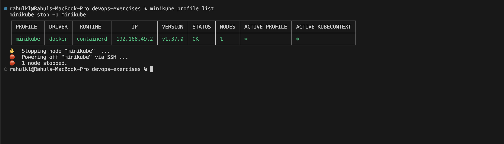

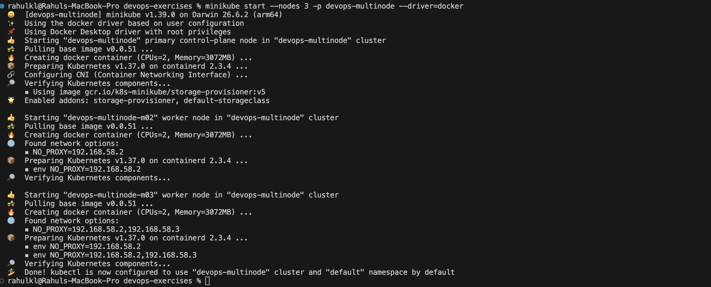

```bash
kubectl get nodes
```


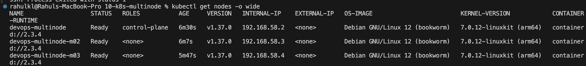

> **Note:** The original exercise includes `minikube delete` and a `--force` flag intended for running Minikube as root on Linux. Neither was needed on macOS, so the delete was replaced by `minikube stop`, and `--force` was omitted. The registry addon step was also skipped, since the images are loaded directly into the nodes with `minikube image load` and the deployments use `imagePullPolicy: Never`.

## Step 2: Product Catalog (AppA) — Flask app

`product_catalog.py`
```python
# product_catalog.py
from flask import Flask, jsonify

app = Flask(__name__)

products = [
    {"id": 1, "name": "Laptop", "price": 1200},
    {"id": 2, "name": "Phone", "price": 800},
    {"id": 3, "name": "Headphones", "price": 150},
]

@app.route("/products", methods=["GET"])
def get_products():
    return jsonify(products)

if __name__ == "__main__":
    app.run(host="0.0.0.0", port=80)
```

## Step 3: Shopping Cart (AppB) — Flask app

`shopping_cart.py`
```python
# shopping_cart.py
from flask import Flask, jsonify, request

app = Flask(__name__)

cart = []

@app.route("/cart", methods=["GET"])
def get_cart():
    return jsonify(cart)

@app.route("/cart", methods=["POST"])
def add_to_cart():
    item = request.json
    cart.append(item)
    return jsonify(cart), 201

if __name__ == "__main__":
    app.run(host="0.0.0.0", port=80)
```

## Step 4: Dockerize both applications

`Dockerfile.product`
```dockerfile
# Dockerfile for Product Catalog
FROM python:3.9-slim
WORKDIR /app
COPY product_catalog.py /app/
RUN pip install flask
CMD ["python", "product_catalog.py"]
```

`Dockerfile.shopping`
```dockerfile
# Dockerfile for Shopping Cart
FROM python:3.9-slim
WORKDIR /app
COPY shopping_cart.py /app/
RUN pip install flask
CMD ["python", "shopping_cart.py"]
```

```bash
docker build -t product-catalog:latest -f Dockerfile.product .
docker build -t shopping-cart:latest -f Dockerfile.shopping .
docker images | grep -E "product-catalog|shopping-cart"
```

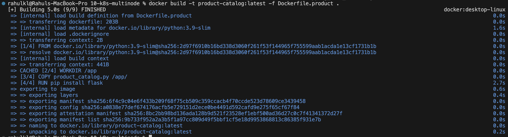

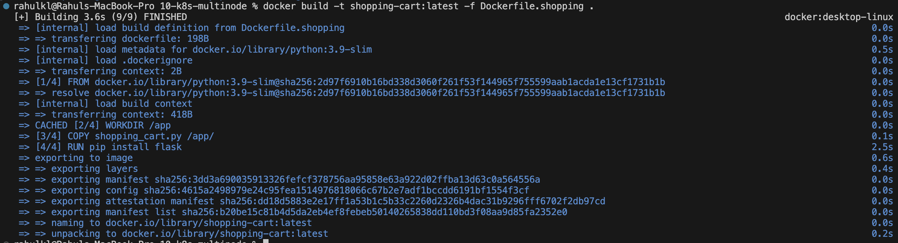


## Step 5: Load images into every node

```bash
minikube -p devops-multinode image load product-catalog:latest
minikube -p devops-multinode image load shopping-cart:latest
```


Each node has its own image store, and with `imagePullPolicy: Never` a missing image on any node would break the pod scheduled there. The cluster uses containerd, so `crictl` was used to check all three nodes:

```bash
for n in devops-multinode devops-multinode-m02 devops-multinode-m03; do echo "== $n"; minikube -p devops-multinode ssh -n $n -- "sudo crictl images | grep -E 'product-catalog|shopping-cart'"; done
```

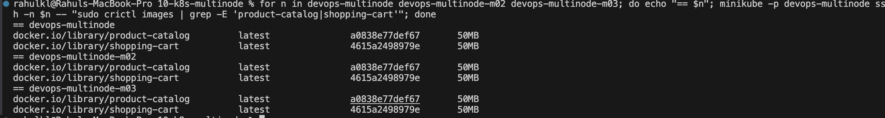

## Step 6: Deploy with pod anti-affinity

`product_catalog_deployment.yaml` — 2 replicas, required anti-affinity on `app: product-catalog`
```yaml
# product_catalog_deployment.yaml
apiVersion: apps/v1
kind: Deployment
metadata:
  name: product-catalog
  namespace: default
spec:
  replicas: 2
  selector:
    matchLabels:
      app: product-catalog
  template:
    metadata:
      labels:
        app: product-catalog
    spec:
      affinity:
        podAntiAffinity:
          requiredDuringSchedulingIgnoredDuringExecution:
          - labelSelector:
              matchLabels:
                app: product-catalog
            topologyKey: "kubernetes.io/hostname"
      containers:
      - name: product-catalog-container
        image: product-catalog:latest
        imagePullPolicy: Never
        ports:
        - containerPort: 80
```

`shopping_cart_deployment.yaml` — 3 replicas, required anti-affinity on `app: shopping-cart`
```yaml
# shopping_cart_deployment.yaml
apiVersion: apps/v1
kind: Deployment
metadata:
  name: shopping-cart
  namespace: default
spec:
  replicas: 3
  selector:
    matchLabels:
      app: shopping-cart
  template:
    metadata:
      labels:
        app: shopping-cart
    spec:
      affinity:
        podAntiAffinity:
          requiredDuringSchedulingIgnoredDuringExecution:
          - labelSelector:
              matchLabels:
                app: shopping-cart
            topologyKey: "kubernetes.io/hostname"
      containers:
      - name: shopping-cart-container
        image: shopping-cart:latest
        imagePullPolicy: Never
        ports:
        - containerPort: 80
```

Both deployments use `requiredDuringSchedulingIgnoredDuringExecution` pod anti-affinity with `topologyKey: "kubernetes.io/hostname"`, which forces the Kubernetes scheduler to place replicas of the same app on different nodes rather than treating it as a soft preference.

> **Bug fixed from the original exercise:** the original `shopping_cart_deployment.yaml` specified `namespace: devops-exercise`, while `product_catalog_deployment.yaml` used `namespace: default` — and no `devops-exercise` namespace was ever created. This mismatch would cause the Shopping Cart deployment to fail. Both manifests were set to `namespace: default` for consistency.

## Step 7: Expose both services

`product_catalog_service.yaml` and `shopping_cart_service.yaml` — both `NodePort` services on port 80.

```yaml
# product_catalog_service.yaml
apiVersion: v1
kind: Service
metadata:
  name: product-catalog-service
  namespace: default
spec:
  selector:
    app: product-catalog
  ports:
    - protocol: TCP
      port: 80
      targetPort: 80
  type: NodePort
```

```yaml
# shopping_cart_service.yaml
apiVersion: v1
kind: Service
metadata:
  name: shopping-cart-service
  namespace: default
spec:
  selector:
    app: shopping-cart
  ports:
    - protocol: TCP
      port: 80
      targetPort: 80
  type: NodePort
```

```bash
kubectl apply -f product_catalog_deployment.yaml
kubectl apply -f shopping_cart_deployment.yaml
kubectl apply -f product_catalog_service.yaml
kubectl apply -f shopping_cart_service.yaml
kubectl rollout status deployment/product-catalog
kubectl rollout status deployment/shopping-cart
```

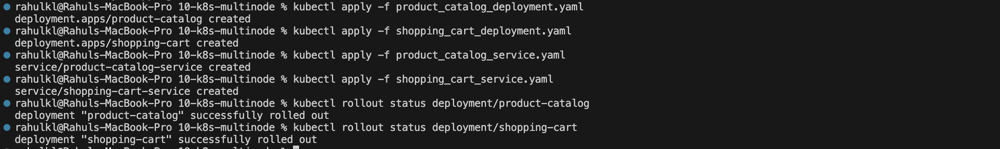

## Step 8: Verify pod distribution across nodes

```bash
kubectl get deployments
kubectl get pods -o wide
kubectl get svc
```

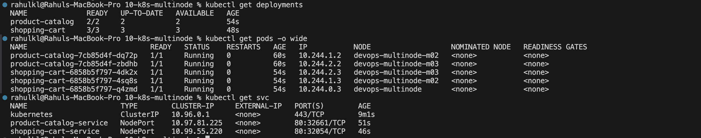

Result confirmed the anti-affinity rules worked as intended:
- **Product Catalog** (2 pods): one on `devops-multinode-m02`, one on `devops-multinode-m03`
- **Shopping Cart** (3 pods): one on `devops-multinode`, one on `devops-multinode-m02`, one on `devops-multinode-m03`

No two replicas of the same service share a node.

## Step 9: Access and test both services

On macOS with the Docker driver, `minikube service` opens a tunnel that only works while its terminal tab stays open, so each service was run in its own tab.

```bash
minikube -p devops-multinode service product-catalog-service
minikube -p devops-multinode service shopping-cart-service
```

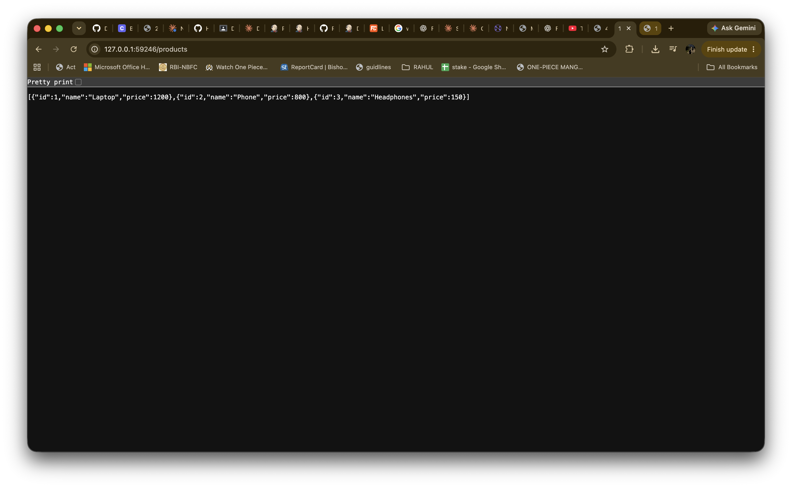


### Test Product Catalog and Shopping Cart
```bash
curl http://127.0.0.1:59246/products
curl http://127.0.0.1:59265/cart
curl -X POST http://127.0.0.1:59265/cart -H "Content-Type: application/json" -d '{"id": 1, "name": "Laptop", "quantity": 1}'
curl http://127.0.0.1:59265/cart
```
```json
[{"id":1,"name":"Laptop","price":1200},{"id":2,"name":"Phone","price":800},{"id":3,"name":"Headphones","price":150}]
[]
[{"id":1,"name":"Laptop","quantity":1}]
[{"id":1,"name":"Laptop","quantity":1}]
```

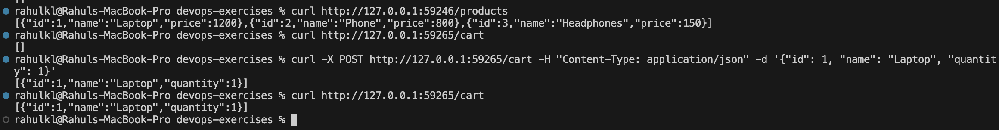

## Step 10: Fault tolerance — delete the Shopping Cart pods

```bash
kubectl delete pod -l app=shopping-cart --wait=false
kubectl get pods -o wide
```

Immediately after deletion the old pods are `Terminating` and the replacements `Pending`. The required anti-affinity rule keeps each new pod waiting until it can be placed on its own node.

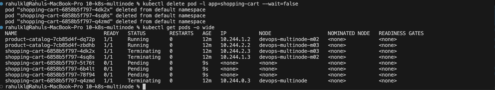

### Platform issue: the cluster was lost and recreated

Before the cart tests could be repeated, `kubectl` stopped working: the `devops-multinode` profile and the kubeconfig context had disappeared, so `kubectl` fell back to `localhost:8080`, where an unrelated Jenkins server answered with a login page. `minikube profile list` showed only the original `minikube` profile. The cause was not identified. The cluster was recreated with the same start command, the images (still present in local Docker) were reloaded, and the manifests were applied again.

Just after the restart the two worker nodes briefly showed `NotReady`:

```
devops-multinode       Ready      control-plane
devops-multinode-m02   NotReady   <none>
devops-multinode-m03   NotReady   <none>
```

They became Ready after roughly a minute, once node networking finished initializing. This is a timing dependency on a resource-constrained local multi-node cluster, not an error. The deployment on the recreated cluster again placed one pod per node:

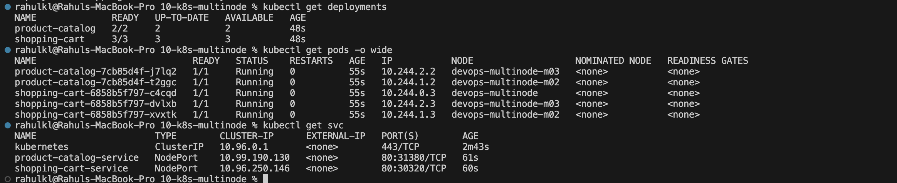

The fault-tolerance test was then repeated, this time waiting 40 seconds before checking:

```bash
kubectl delete pod -l app=shopping-cart --wait=false
sleep 40
kubectl get pods -o wide
```


All three replacement pods are Running, one on each node, and the two Product Catalog pods were not affected.

## Summary
Deployed two Python Flask applications on a 3-node Minikube cluster with ReplicaSets, using pod anti-affinity to guarantee each replica runs on a distinct node. This maximizes availability and fault tolerance: a single node failure would not take down an entire service, since replicas are deliberately spread across the cluster. Deleting the Shopping Cart pods showed Kubernetes recreating them on separate nodes automatically.

## Key Takeaways
- `requiredDuringSchedulingIgnoredDuringExecution` pod anti-affinity is a hard constraint — the scheduler will leave a pod `Pending` rather than violate it, unlike the `preferred` variant which is a soft hint.
- A multi-node local cluster has more moving parts than single-node: worker nodes can briefly report `NotReady` while networking initializes, which resolves on its own given a little time.
- `minikube image load` copies the image into each node's own store, and with `imagePullPolicy: Never` every node must have it. No registry addon is needed.
- Namespace consistency across related manifests matters: a mismatched `namespace` field between a Deployment and its dependencies is a common, easy-to-miss source of deployment failures.
- The cart is stored in each pod's memory, so with 3 replicas behind one Service each pod has its own separate cart, and the cart is lost when a pod is deleted. A production design would keep the cart in a shared store such as Redis or a database.
