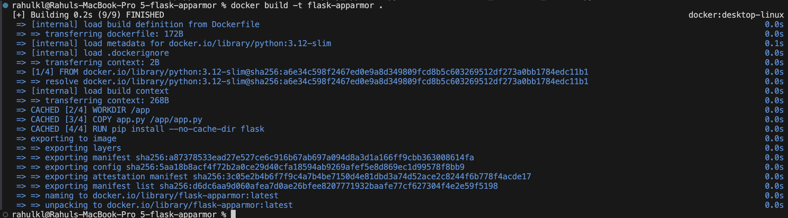
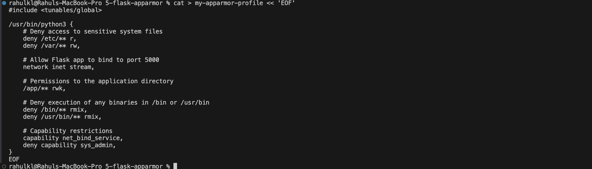
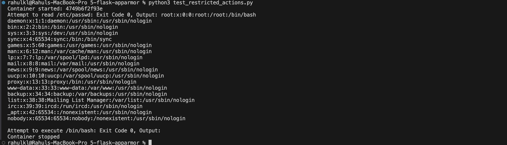

# Exercise 5: Docker Security with AppArmor and Python

## Objective
Secure a containerized Python (Flask) application with an AppArmor profile, apply the profile through the Docker SDK for Python, and test restricted actions (reading `/etc/passwd`, executing `/bin/bash`) inside the container.

## Scenario
A Python Flask web application runs inside a Docker container. The container should be restricted from reading sensitive directories and from executing binaries. The Docker SDK for Python is used to start the container with the profile and to check which security options were applied. Python scripts then try the restricted actions.

## Important Finding: AppArmor Is Not Available on macOS

This exercise was run on a MacBook with Docker Desktop. **AppArmor is a Linux kernel security module.** On macOS, Docker Desktop runs containers inside a small Linux virtual machine, and that VM does not have AppArmor enabled.

Checking the security features the Docker daemon supports:

```bash
docker info --format '{{.SecurityOptions}}'
```
```
[name=seccomp,profile=builtin name=cgroupns]
```

The list contains `seccomp` and `cgroupns` but **no `apparmor`**. This means the `apparmor=my-apparmor-profile` option passed to Docker is accepted, but it is not enforced. As a result, the restricted actions in Task 5 are **not blocked** in this environment. The outputs below are the real results from this machine and are explained in the sections that follow.

## Files in This Folder

| File | Purpose |
|---|---|
| `app.py` | The Flask application |
| `Dockerfile` | Builds the `flask-apparmor` image from `python:3.12-slim` |
| `my-apparmor-profile` | The AppArmor profile (Task 3) |
| `apply_apparmor.py` | Builds and starts the container with the profile using the Docker SDK (Task 4) |
| `test_restricted_actions.py` | Tries the restricted actions inside the container (Task 5) |

## Prerequisites

```bash
docker --version
python3 --version
pip3 install docker
```
The Docker SDK for Python (`docker`) provides the `docker.from_env()` client used by both scripts. Docker Desktop must be running.

## Task 1 and 2: Flask Application and Dockerfile

`app.py` is a small Flask app that listens on port 5000 and returns a greeting.

`app.py`
```python
from flask import Flask

app = Flask(__name__)

@app.route('/')
def home():
    return "Hello, this is a secure Flask application running inside a Docker container!"

if __name__ == '__main__':
    app.run(host='0.0.0.0', port=5000)
```

The `Dockerfile` uses `python:3.12-slim` as the base image, sets `/app` as the working directory, copies the application in, installs Flask with `pip`, and starts the app.

`Dockerfile`
```dockerfile
FROM python:3.12-slim
WORKDIR /app
COPY app.py /app/app.py
RUN pip install --no-cache-dir flask
EXPOSE 5000
CMD ["python", "app.py"]
```

Build the image:

```bash
docker build -t flask-apparmor .
```



The image was built and tagged `flask-apparmor:latest`. Some layers show `CACHED` because the image had been built before.

## Task 3: The AppArmor Profile

The profile restricts the application's access to sensitive directories, binary execution, and capabilities.

`my-apparmor-profile`
```
#include <tunables/global>

/usr/bin/python3 {
    # Deny access to sensitive system files
    deny /etc/** r,
    deny /var/** rw,

    # Allow Flask app to bind to port 5000
    network inet stream,

    # Permissions to the application directory
    /app/** rwk,

    # Deny execution of any binaries in /bin or /usr/bin
    deny /bin/** rmix,
    deny /usr/bin/** rmix,

    # Capability restrictions
    capability net_bind_service,
    deny capability sys_admin,
}
```



What each rule does:

| Rule | Effect |
|---|---|
| `deny /etc/** r` | No reading of anything under `/etc` (for example `/etc/passwd`) |
| `deny /var/** rw` | No reading or writing under `/var` |
| `network inet stream` | Allows TCP networking so Flask can listen on port 5000 |
| `/app/** rwk` | Read, write and lock access to the application directory |
| `deny /bin/** rmix`, `deny /usr/bin/** rmix` | No reading, mapping or executing of binaries in these directories (this blocks shells and common tools) |
| `capability net_bind_service` | Allows binding to ports |
| `deny capability sys_admin` | Blocks the powerful `CAP_SYS_ADMIN` capability |

On a Linux host with AppArmor, the profile is stored in `/etc/apparmor.d/` and loaded with `sudo apparmor_parser -r /etc/apparmor.d/my-apparmor-profile`. This step cannot be done on macOS, so the profile file is kept in this folder as a record.

## Task 4: Applying the Profile with the Docker SDK

`apply_apparmor.py` builds the image, starts the container with `security_opt=["apparmor=my-apparmor-profile"]`, inspects it, prints the result, and then stops and removes the container.

`apply_apparmor.py`
```python
import docker

client = docker.from_env()

print("Building Docker image...")
client.images.build(path=".", tag="flask-apparmor")

print("Starting container...")
container = client.containers.run(
    "flask-apparmor",
    ports={"5000/tcp": 5001},
    security_opt=["apparmor=my-apparmor-profile"],
    detach=True
)

print(f"Container started: {container.short_id}")

container_info = client.api.inspect_container(container.id)

print("AppArmor profile:", container_info.get("AppArmorProfile"))
print(
    "Security options:",
    container_info["HostConfig"].get("SecurityOpt")
)

print("Container logs:")
print(container.logs().decode())

container.stop()
container.remove()
print("Container stopped and removed.")
```

The script publishes the container's port 5000 on host port **5001** instead of 5000, because macOS can have port 5000 reserved by AirPlay Receiver. The script prints two values from `docker inspect`: the AppArmor profile in effect (`AppArmorProfile`) and the options requested (`HostConfig.SecurityOpt`).

```bash
python3 apply_apparmor.py
```
Output:
```
Building Docker image...
Starting container...
Container started: 59dd6a9995bc
AppArmor profile: 
Security options: ['apparmor=my-apparmor-profile']
Container logs:

Container stopped and removed.
```

How to read the two lines:
- **Security options: `['apparmor=my-apparmor-profile']`** is the option that was **requested**. Docker stores it in the container's `HostConfig.SecurityOpt` whether or not it can be enforced.
- **AppArmor profile:** (empty) is the profile that is actually **in effect** on the container, taken from the container's `AppArmorProfile` field. On a Linux host with AppArmor it would show the profile name. It is empty here, which is consistent with AppArmor not being active.

So checking only `SecurityOpt` is not proof that a profile is enforced. The `AppArmorProfile` field gives the more reliable answer.

## Task 5: Testing Restricted Actions

`test_restricted_actions.py` starts the container with the profile, runs `cat /etc/passwd` and `/bin/bash` inside it with `container.exec_run`, prints the exit code and output of each, and then stops and removes the container. No port is published because the test only runs commands inside the container.

`test_restricted_actions.py`
```python
import docker

# Create a Docker client
client = docker.from_env()

# Run the container with the AppArmor option
container = client.containers.run(
    "flask-apparmor",
    security_opt=["apparmor=my-apparmor-profile"],
    detach=True
)

print(f"Container started: {container.short_id}")

# Test reading /etc/passwd
result = container.exec_run("cat /etc/passwd")
print(
    f"Attempt to read /etc/passwd: "
    f"Exit Code {result.exit_code}, "
    f"Output: {result.output.decode(errors='replace')}"
)

# Test executing /bin/bash
result = container.exec_run("/bin/bash")
print(
    f"Attempt to execute /bin/bash: "
    f"Exit Code {result.exit_code}, "
    f"Output: {result.output.decode(errors='replace')}"
)

# Stop and remove the container
container.stop()
container.remove()
print("Container stopped")
```

```bash
python3 test_restricted_actions.py
```



Results on this machine:

| Action | Exit code observed | Exit code expected with AppArmor enforced |
|---|---|---|
| `cat /etc/passwd` | **0**, file contents printed | Non-zero (access denied) |
| `/bin/bash` | **0** | `126` (permission denied when executing) |

Both actions **succeeded**. `/etc/passwd` was printed in full (`root:x:0:0:root:/root:/bin/bash` and the other system accounts), and `/bin/bash` started without any error. This is the expected result when AppArmor is not enforced, and it confirms the finding above: the profile was requested, but nothing applied it.

## Why It Behaves This Way

1. Docker accepts any `apparmor=<name>` security option and records it, but the Linux kernel is what enforces it.
2. Docker Desktop for Mac runs containers in a Linux VM whose kernel does not have AppArmor enabled, as shown by `docker info`.
3. With no AppArmor module, the profile is never loaded and no rule is checked, so the container runs with no AppArmor restrictions.

This exercise was run on macOS for the Docker, Python SDK and scripting parts. To see the restrictions actually take effect, the same scripts have to run on a Linux host with AppArmor, such as Ubuntu.

## Reproducing with Enforcement on Linux

On an Ubuntu or Debian machine with Docker installed:

1. Install the utilities: `sudo apt-get update && sudo apt-get install apparmor-utils`
2. Confirm AppArmor is active: `docker info --format '{{.SecurityOptions}}'` should list `name=apparmor`.
3. Save the profile in `/etc/apparmor.d/` and load it with `sudo apparmor_parser -r /etc/apparmor.d/my-apparmor-profile`.
4. Run the scripts and check the enforced profile with `docker inspect --format '{{.AppArmorProfile}}' <container>`.

The profile in this exercise is a starting point and needs adjusting on a real host. AppArmor matches a profile by its **name**, and Docker is told to use `my-apparmor-profile`, so the profile has to be declared with that name (for example `profile my-apparmor-profile flags=(attach_disconnected) { ... }`) rather than as `/usr/bin/python3 { ... }`. The `python:3.12-slim` image also runs Python from `/usr/local/bin/`, not `/usr/bin/python3`, and denying all of `/etc` also blocks files the Python runtime itself needs. A working profile has to allow what Python needs and deny only what should be blocked.

## Questions and Answers

**1. What is the purpose of using AppArmor with Docker containers?**
AppArmor is a Linux Mandatory Access Control system. It confines a program to a defined set of files, network access and capabilities. For Docker, it adds a layer of protection around the container, so that a compromised application cannot reach resources it does not need.

**2. How do AppArmor profiles help secure a Docker container?**
A profile lists what the containerized process may and may not do: which files it can read, write or execute, which network operations it can use, and which Linux capabilities it holds. Anything not allowed is blocked by the kernel, which limits the damage if the application is exploited and protects the host.

**3. Why is it important to restrict access to sensitive directories such as `/etc/` and `/var/`?**
`/etc` holds configuration, user accounts and credentials-related files, and `/var` holds logs, caches and application data. If an attacker could read or change them, they could learn about the system, steal secrets or tamper with it. Restricting access follows the principle of least privilege.

**4. What other capabilities can you restrict using AppArmor profiles?**
Network access (protocols, sockets, specific operations), file permissions (read, write, execute, lock, link), execution of specific binaries, mounting filesystems, signals sent to other processes, ptrace, and Linux capabilities such as `sys_admin`, `net_raw` or `sys_ptrace`.

**5. How can you verify if an AppArmor profile is successfully applied to a Docker container?**
Check that the host supports AppArmor with `docker info --format '{{.SecurityOptions}}'` (it must list `name=apparmor`), then inspect the container. `HostConfig.SecurityOpt` shows the profile that was **requested**, and the `AppArmorProfile` field shows the profile that is **in effect**. On the host, `sudo aa-status` lists the loaded profiles, and the restricted actions should be denied when tested. In this run, the `AppArmorProfile` field was empty and the actions succeeded, so the profile was not enforced.

## Cleanup

Both scripts stop their containers, but stopped containers can remain. List and remove any left from this image:

```bash
docker ps -a --filter ancestor=flask-apparmor
docker rm -f $(docker ps -aq --filter ancestor=flask-apparmor)
```

## Summary

| Step | Result |
|---|---|
| Image build | Succeeded, image `flask-apparmor` |
| AppArmor profile | Written and saved in `my-apparmor-profile` |
| Docker SDK script | Container started and the option `apparmor=my-apparmor-profile` was recorded, but the in-effect profile was empty |
| Restricted-action tests | Not blocked (exit codes 0 and 0), because Docker Desktop on macOS has no AppArmor |
| Conclusion | Enforcement needs a Linux host with AppArmor enabled |
