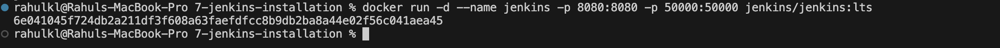
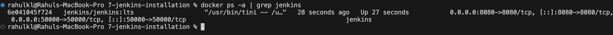
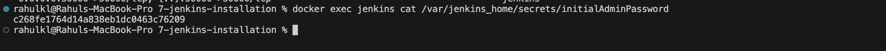
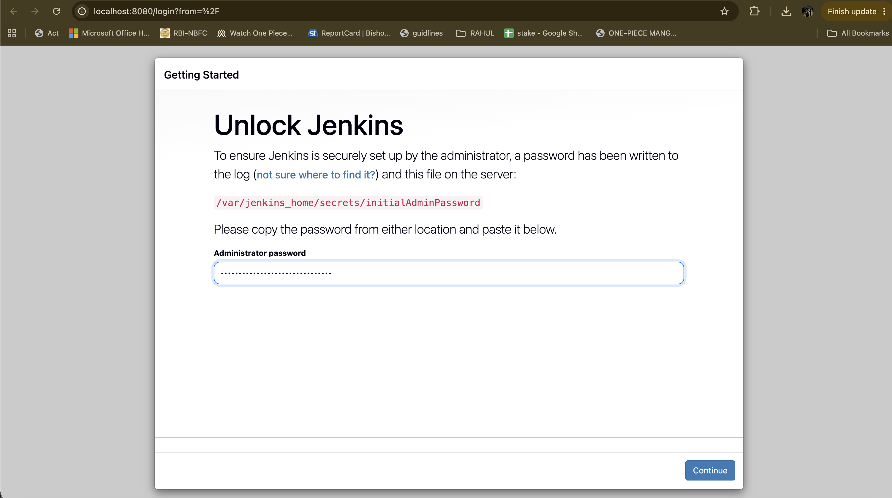
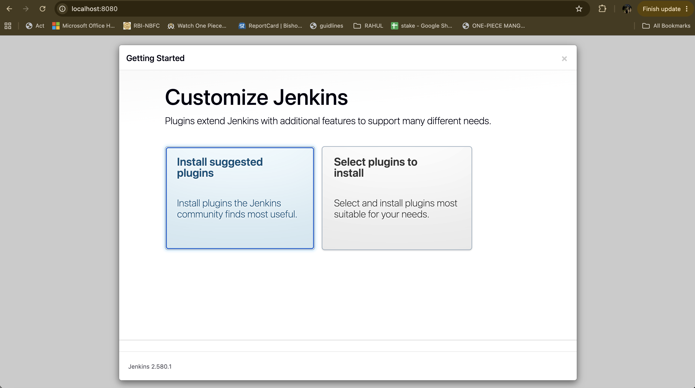
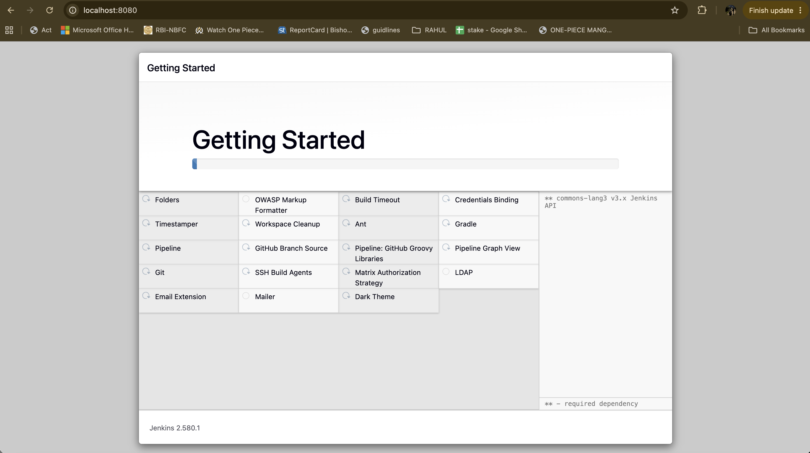
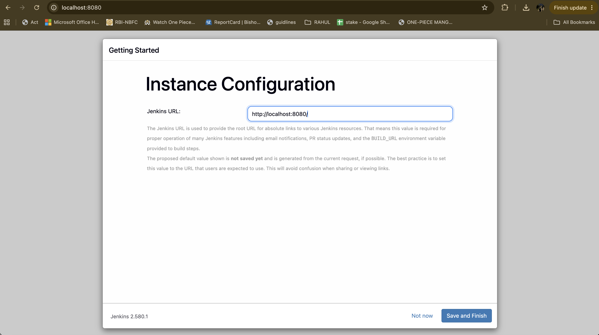
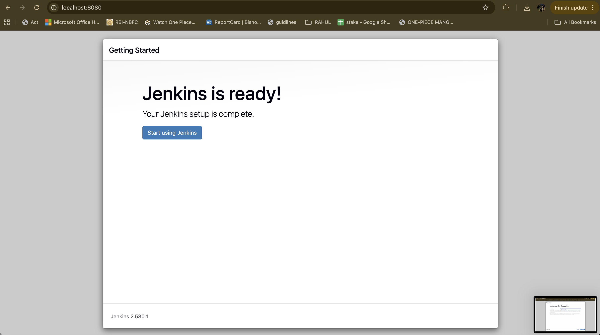
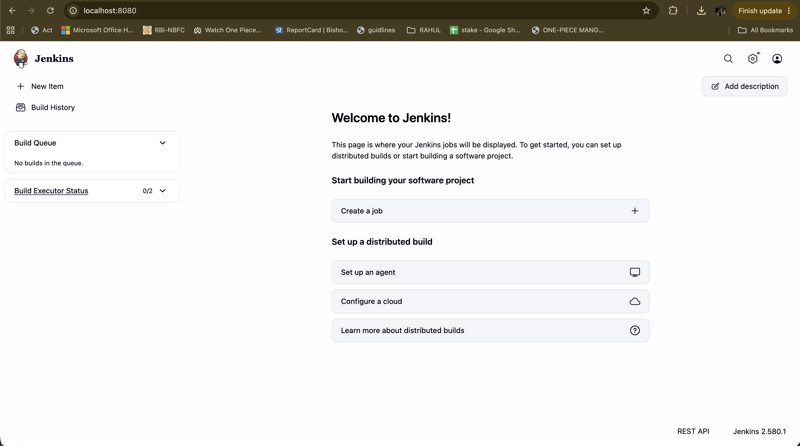

# Exercise 7: Introduction to Continuous Integration (CI) and Jenkins Installation

## Objective
Understand what Continuous Integration is and why it matters, then install and set up Jenkins using Docker so it is ready to run CI/CD pipeline jobs.

## What is Continuous Integration (CI)?
Continuous Integration is a development practice where developers frequently integrate code changes into a shared repository. Each integration is automatically built and tested, catching errors early and improving software quality.

## Key Features of CI
- **Frequent Code Integration**: developers commit changes multiple times a day
- **Automated Builds**: every commit triggers an automated build
- **Automated Testing**: tests run automatically to catch regressions
- **Immediate Feedback**: developers get a quick signal on whether their changes broke anything

## Benefits of CI
- Early bug detection, before issues compound
- Improved collaboration across a shared codebase
- Faster development cycles through automation
- Higher overall code quality via continuous testing

## How CI Works
1. A developer pushes code to version control (for example Git)
2. The CI server detects the change and triggers a build
3. The codebase is compiled and dependencies are resolved
4. Automated tests run to verify functionality
5. Results are reported back to the developer

## What is Jenkins?
Jenkins is an open-source automation server used to build, test, and deploy software, enabling both Continuous Integration and Continuous Delivery. It is extensible via plugins, can run distributed builds across multiple machines, and remains one of the most widely used CI servers.

## Key Jenkins Concepts
- **Job/Project**: a task or process Jenkins runs
- **Build**: the process of compiling and packaging code
- **Pipeline**: a series of steps to build, test, and deploy an application
- **Plugins**: extend Jenkins' functionality (Git, Docker, etc.)
- **Nodes**: machines where Jenkins runs jobs (Master/Agent setup)

## Prerequisites
- Docker Desktop installed and running (check with `docker --version` and `docker info`)
- Port **8080** (web interface) and **50000** (agent communication) free on the host

If a Jenkins container from an earlier exercise is still running, remove it first so the ports are free:
```bash
docker rm -f jenkins
```

## Installing Jenkins via Docker

### Step 1: Run the Jenkins container

```bash
docker run -d --name jenkins -p 8080:8080 -p 50000:50000 jenkins/jenkins:lts
```

- `-p 8080:8080` exposes the Jenkins web interface on the host's port 8080
- `-p 50000:50000` exposes the port used by build agents to connect to Jenkins



### Step 2: Verify the container is running

```bash
docker ps -a | grep jenkins
```

The status should read `Up`, with ports `8080` and `50000` mapped.



### Step 3: Retrieve the initial admin password

```bash
docker exec -it jenkins cat /var/jenkins_home/secrets/initialAdminPassword
```

If this prints nothing, wait about 30 seconds for Jenkins to finish starting and run it again.



### Step 4: Access Jenkins and unlock it

Open [http://localhost:8080](http://localhost:8080) and paste the password from Step 3.



### Step 5: Install suggested plugins

Choose **Install suggested plugins** and wait for the installation to finish. If any plugin shows a red ✗ (usually a download timeout), click **Retry**.





### Step 6: Create an admin user, then confirm the instance URL

Create the first admin user. The default instance URL (`http://localhost:8080`) is correct for local use.



### Step 7: Jenkins is ready

Click **Start using Jenkins** to open the landing page and the dashboard.





Jenkins is now fully installed, unlocked, and accessible at `http://localhost:8080`, ready to create and run CI/CD pipeline jobs.

### Step 8: Verify the installation

Confirm that the container is up, the web interface responds, and Jenkins finished starting:

```bash
docker ps --format "table {{.Names}}\t{{.Status}}\t{{.Ports}}"
curl -sI http://localhost:8080/login | grep -i x-jenkins
docker exec jenkins java -version
docker logs jenkins 2>&1 | grep "fully up and running"
```

- `docker ps` shows the container with status `Up` and ports 8080 and 50000 mapped
- The `X-Jenkins` header confirms the web interface is serving and shows the Jenkins version
- `java -version` confirms the Java runtime inside the container
- The log line confirms startup completed

## Troubleshooting

| Problem | Fix |
|---|---|
| `port is already allocated` | Another container is using 8080 or 50000. Run `docker rm -f jenkins`, or find the process with `lsof -i :8080`. |
| `container name "/jenkins" is already in use` | Run `docker rm -f jenkins`, then repeat Step 1. |
| Browser shows "can't connect" | Jenkins takes 30 to 60 seconds to start. Check `docker logs jenkins` for "Jenkins is fully up and running". |
| Password command prints nothing | Jenkins is still starting. Wait and run the command again. |
| Plugin install shows a red ✗ | Click **Retry**, or continue and install the plugin later from **Manage Jenkins → Plugins**. |

## Next Steps
With Jenkins running, the natural follow-up is building an actual pipeline job (a `Jenkinsfile`) that automates building, testing, and deploying one of the applications from earlier exercises, such as the Flask app or the delivery monitoring stack (Exercise 6).
