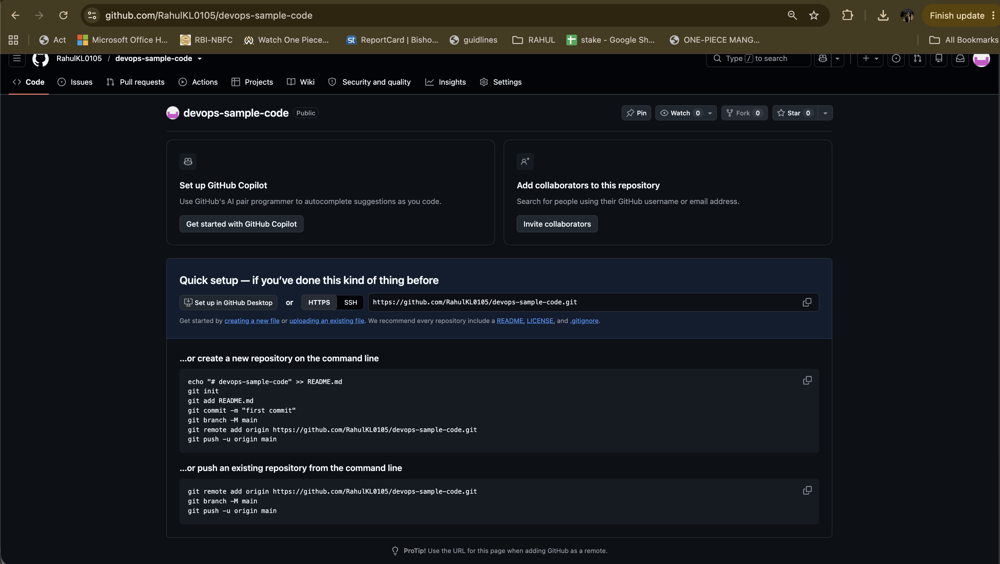
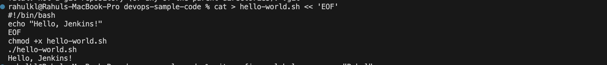
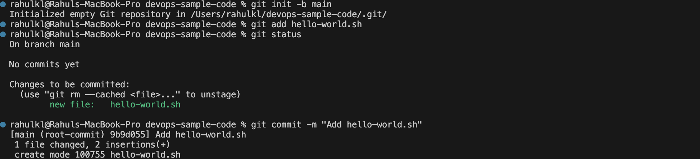
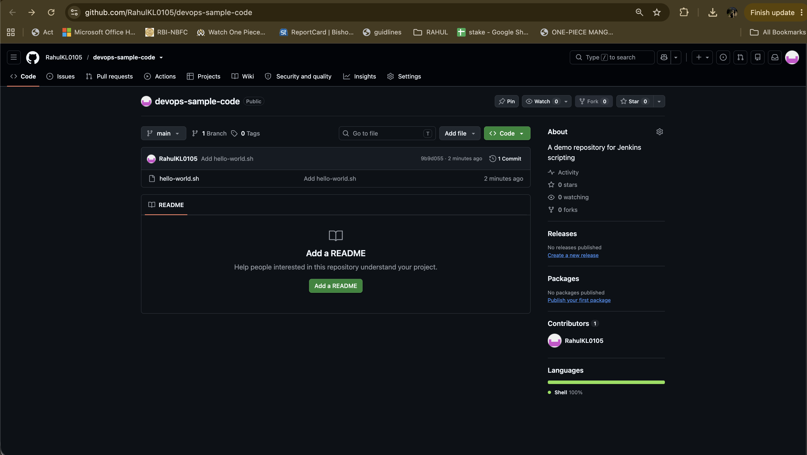
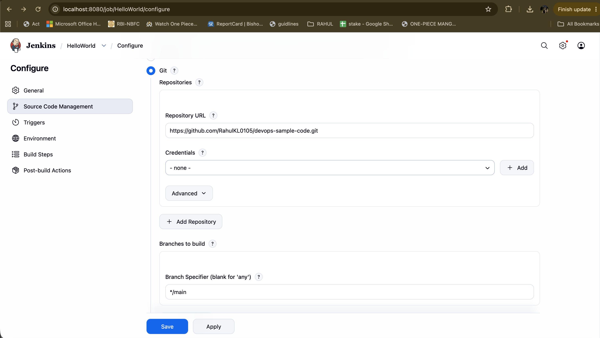
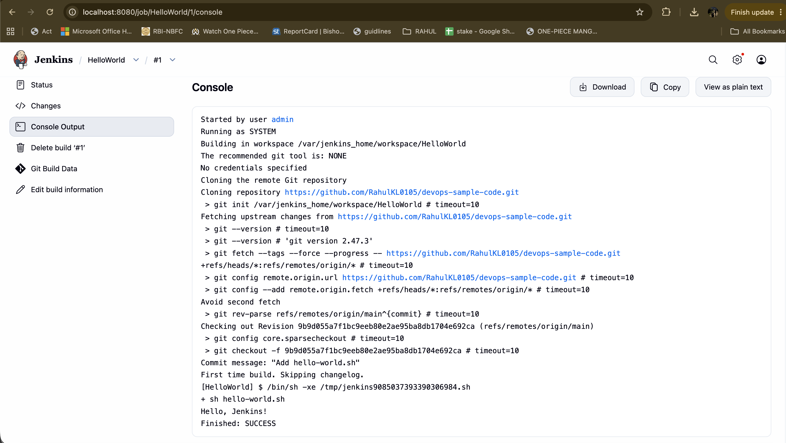

# Exercise 8: Creating a "Hello World" Jenkins Job

## Objective
Put a simple shell script on GitHub, then create a Jenkins Freestyle job that pulls the script from the repository and runs it. This shows the basic Jenkins flow: source code management, a build step, and the console output of a build.

## Key Concepts
- **Freestyle project**: the simplest Jenkins job type, configured through the web UI
- **Source Code Management (SCM)**: tells Jenkins which Git repository and branch to pull before each build
- **Build step**: a task Jenkins runs after checkout, such as an "Execute shell" command
- **Workspace**: the folder inside Jenkins where the repository is checked out and the build runs
- **Console Output**: the full log of a build, ending in `Finished: SUCCESS` or `Finished: FAILURE`

## Prerequisites
- A GitHub account
- Git installed (`git --version`)
- Jenkins running in Docker and already set up (Exercise 7): [http://localhost:8080](http://localhost:8080)

Check that Jenkins is up:
```bash
docker ps --format "table {{.Names}}\t{{.Status}}\t{{.Ports}}"
```
If the container is stopped, start it with `docker start jenkins`.

## Part A: Put `hello-world.sh` on GitHub

### Step 1: Create the GitHub repository

1. Sign in to [https://github.com](https://github.com).
2. Click **+** (top right) → **New repository**.
3. Set **Repository name** to `devops-sample-code`.
4. Set **Description** to `A demo repository for Jenkins scripting`.
5. Set **Visibility** to **Public**.
6. Leave "Add a README", ".gitignore" and "license" **unchecked**, so the repository starts empty and the first push has no conflicts.
7. Click **Create repository**.



### Step 2: Create a personal access token

GitHub no longer accepts account passwords for `git push` over HTTPS, so a personal access token (PAT) is used instead.

1. Go to **GitHub → profile picture → Settings → Developer settings → Personal access tokens**.
2. Create a **fine-grained token**:
   - **Repository access**: **Only select repositories** → `devops-sample-code`
   - **Repository permissions**: click **Add permissions**, add **Contents**, and set it to **Read and write**
   - Keep the expiration short (7 to 30 days)
3. Copy the token immediately. GitHub shows it only once.

A classic token with the **repo** scope also works. The token must never be committed, shared or screenshotted, and should be deleted when the exercise is finished.

### Step 3: Create the script locally

The repository is created outside other Git repositories to avoid nesting one inside another:
```bash
mkdir -p ~/devops-sample-code && cd ~/devops-sample-code
git rev-parse --show-toplevel
```
The second command should print `fatal: not a git repository`, which confirms the folder is not inside another repository.

```bash
cat > hello-world.sh << 'EOF'
#!/bin/bash
echo "Hello, Jenkins!"
EOF
chmod +x hello-world.sh
./hello-world.sh
```
Expected output:
```
Hello, Jenkins!
```



### Step 4: Initialize Git and commit

```bash
git config --global user.name "Your Name"
git config --global user.email "your-email@example.com"
git init -b main
git add hello-world.sh
git status
```
`git init -b main` names the branch `main` from the start. Plain `git init` can create `master` on some systems, which would not match the `main` branch used later.

`git status` shows:
```
On branch main

No commits yet

Changes to be committed:
  (use "git rm --cached <file>..." to unstage)
        new file:   hello-world.sh
```

Commit:
```bash
git commit -m "Add hello-world.sh"
```
Output:
```
[main (root-commit) 9b9d055] Add hello-world.sh
 1 file changed, 2 insertions(+)
 create mode 100755 hello-world.sh
```
The file mode `100755` confirms the script is executable.



### Step 5: Link to GitHub and push

```bash
git remote add origin https://github.com/RahulKL0105/devops-sample-code.git
git push -u origin main
```
When prompted, enter your GitHub username, and paste the **token** as the password (nothing is displayed while pasting).

Output:
```
Enumerating objects: 3, done.
Counting objects: 100% (3/3), done.
Writing objects: 100% (3/3), 257 bytes | 257.00 KiB/s, done.
Total 3 (delta 0), reused 0 (delta 0), pack-reused 0 (from 0)
To https://github.com/RahulKL0105/devops-sample-code.git
 * [new branch]      main -> main
branch 'main' set up to track 'origin/main'.
```

### Step 6: Verify on GitHub

Open [https://github.com/RahulKL0105/devops-sample-code](https://github.com/RahulKL0105/devops-sample-code). The repository shows `hello-world.sh`, the commit `Add hello-world.sh` (`9b9d055`), one branch (`main`), and the description.



## Part B: Create the Jenkins job

### Step 7: Open Jenkins and create a Freestyle project

1. Open [http://localhost:8080](http://localhost:8080) and sign in.
2. On the dashboard, click **New Item**.
3. Enter the name `HelloWorld`.
4. Select **Freestyle project** and click **OK**.

### Step 8: Configure the job

**General**
- **Description**: `Hello World! Jenkins job.`

**Source Code Management**
- Select **Git**
- **Repository URL**: `https://github.com/RahulKL0105/devops-sample-code.git`
- **Credentials**: `- none -` (the repository is public, so no credentials are needed)
- **Branch Specifier**: `*/main`

The default branch specifier is `*/master`. It has to be changed to `*/main` to match the branch that was pushed, otherwise the build fails with `Couldn't find any revision to build`.



**Build Steps**
- Click **Add build step → Execute shell** and enter:
  ```bash
  sh hello-world.sh
  ```

Click **Save**.

### Step 9: Run the job

1. On the `HelloWorld` job page, click **Build Now**.
2. Under **Build History**, click the build number (**#1**).
3. Click **Console Output**.

### Step 10: View the build output



The key lines of the log:
```
Started by user admin
Running as SYSTEM
Building in workspace /var/jenkins_home/workspace/HelloWorld
No credentials specified
Cloning repository https://github.com/RahulKL0105/devops-sample-code.git
...
Checking out Revision 9b9d055a7f1bc9eeb80e2ae95ba8db1704e692ca (refs/remotes/origin/main)
Commit message: "Add hello-world.sh"
[HelloWorld] $ /bin/sh -xe /tmp/jenkins9085037393390306984.sh
+ sh hello-world.sh
Hello, Jenkins!
Finished: SUCCESS
```

How to read it:
- **Cloning repository** and **Checking out Revision** show Jenkins pulled the code from GitHub. The revision `9b9d055` is the same commit that was pushed in Step 4.
- `+ sh hello-world.sh` is the Execute shell step, and `Hello, Jenkins!` is the script's output.
- `Finished: SUCCESS` means the build passed.

## Troubleshooting

| Problem | Fix |
|---|---|
| `Couldn't find any revision to build` | The branch specifier is still `*/master`. Change it to `*/main` under **Configure → Source Code Management**, then rebuild. |
| `Repository not found` in the console | Check the repository URL for typos and make sure the repository is **Public**. |
| `sh: hello-world.sh: not found` | The script must be at the top level of the repository. Check on GitHub. |
| Push rejected with `fetch first` | The repository was created with a README. Run `git pull --rebase origin main`, then push again. |
| Push fails with 403 or permission denied | The token needs **Contents: Read and write** on `devops-sample-code`, and the fine-grained token's repository access must not be set to public read-only. |
| Cannot find the Contents permission | Set **Repository access** to **Only select repositories** first, then use **Add permissions** under repository permissions. A classic token with the `repo` scope is an alternative. |

## Expected Outputs: Achieved

1. **GitHub repository** `devops-sample-code` created with `hello-world.sh` pushed to `main`.
2. **Jenkins Freestyle job** `HelloWorld` configured with Git as the source and an Execute shell build step.
3. **Successful build** where Jenkins cloned the repository, ran the script, printed `Hello, Jenkins!`, and finished with `SUCCESS`.

## Cleanup (optional)

Delete the personal access token on GitHub when the exercise is finished (**Settings → Developer settings → Personal access tokens**).
