# Exercise 6: Real-Time Operations Monitoring and Alerting

## Objective
Build a monitoring pipeline for a simulated delivery service. Python generates live metrics, Prometheus scrapes them and evaluates alert rules, Grafana visualizes them on a dashboard, and Jenkins automates building and running the whole stack.

## Scenario
As a DevOps engineer at ZAPPTTO, a fast-paced delivery service, create a pipeline that simulates delivery metrics, visualizes them on dashboards, and sets up automated alerts to catch operational issues in real time.

## Tools Used
| Tool | Purpose |
|---|---|
| Python 3.12 + `prometheus-client` | Simulate and expose delivery metrics |
| Docker | Containerize and run all services |
| Prometheus | Scrape metrics and evaluate alert rules |
| Grafana | Dashboards and visualization |
| Jenkins | Pipeline automation |

## Project Structure
```
delivery_monitoring/
├── delivery_metrics.py   # Python script that simulates delivery metrics
├── prometheus.yml        # Prometheus scrape configuration
├── alert_rules.yml       # Prometheus alert rules
├── Dockerfile            # Image for the metrics application
├── Jenkinsfile           # Jenkins pipeline script
└── Images/               # Screenshots used in this README
```

## Platform Note: macOS Docker Networking

The original exercise relies on Linux-specific networking (`--network=host` and the bridge IP `172.17.0.1`). **Docker Desktop for macOS does not support host networking the same way**, because containers run inside a lightweight VM instead of sharing the host's network stack.

The fix used here is the special DNS name **`host.docker.internal`**, which resolves to the host machine from inside any container. Prometheus therefore scrapes `host.docker.internal:8000`, and Grafana reaches Prometheus at `http://host.docker.internal:9090`.

If `host.docker.internal` does not resolve on your setup, add `--add-host=host.docker.internal:host-gateway` to the `docker run` commands for Prometheus and Grafana.

## Prerequisites

```bash
docker --version
python3 --version        # needs 3.10+
pip3 install prometheus-client
```

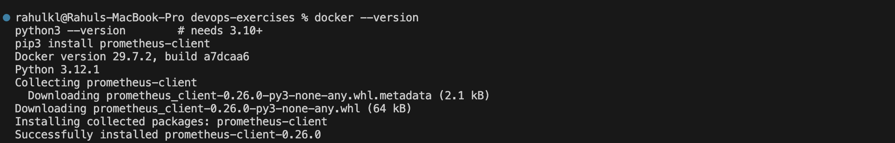

## Step 1: Create the project folder

```bash
mkdir delivery_monitoring && cd delivery_monitoring
```

## Step 2: Write the metrics simulation script

`delivery_metrics.py`
```python
from prometheus_client import start_http_server, Summary, Gauge
import random, time

total_deliveries = Gauge("total_deliveries", "Total number of deliveries")
pending_deliveries = Gauge("pending_deliveries", "Number of pending deliveries")
on_the_way_deliveries = Gauge("on_the_way_deliveries", "Number of deliveries on the way")
average_delivery_time = Summary("average_delivery_time", "Average delivery time in seconds")

def simulate_delivery():
    pending = random.randint(10, 20)
    on_the_way = random.randint(5, 20)
    delivered = random.randint(30, 70)
    avg_time = random.uniform(15, 45)
    total = pending + on_the_way + delivered

    print(f"[DEBUG] Total: {total} | Pending: {pending} | On the way: {on_the_way} | Avg time: {avg_time:.2f}s")

    total_deliveries.set(total)
    pending_deliveries.set(pending)
    on_the_way_deliveries.set(on_the_way)
    average_delivery_time.observe(avg_time)

if __name__ == "__main__":
    print("[INFO] Starting HTTP server on port 8000...")
    start_http_server(8000, addr="0.0.0.0")
    while True:
        simulate_delivery()
        time.sleep(1)
```

**How it works**
- `start_http_server(8000)` from `prometheus_client` automatically exposes a `/metrics` endpoint.
- Each metric has a name, a description, and a type. `Gauge` is used for values that go up and down, and `Summary` tracks the sum and count of observed values, which lets us compute an average.
- Every second the script generates new random values and updates the metrics.

## Step 3: Verify the metrics endpoint

```bash
python3 delivery_metrics.py
```
In a second terminal:
```bash
curl -s http://localhost:8000/metrics | grep deliver
```

The custom metrics `total_deliveries`, `pending_deliveries`, `on_the_way_deliveries`, and `average_delivery_time` (`_count` and `_sum`) are visible. Stop the script with **Ctrl+C** afterward, because the Jenkins pipeline runs it in Docker and needs port 8000.

## Step 4: Configure Prometheus

`prometheus.yml`
```yaml
global:
  scrape_interval: 5s
  evaluation_interval: 5s

rule_files:
  - /etc/prometheus/alert_rules.yml

scrape_configs:
  - job_name: "prometheus"
    static_configs:
      - targets: ["localhost:9090"]

  - job_name: "delivery_service"
    static_configs:
      - targets: ["host.docker.internal:8000"]
```

- `scrape_configs` defines the scraping jobs, and `targets` lists the endpoints Prometheus reads metrics from.
- The scrape interval is set to 5 seconds (the Prometheus default is 15 seconds) so that alerts react faster.

## Step 5: Configure alert rules

`alert_rules.yml`
```yaml
groups:
  - name: delivery_alerts
    rules:
      - alert: HighPendingDeliveries
        expr: pending_deliveries > 30
        for: 15s
        labels:
          severity: critical
        annotations:
          summary: "High pending deliveries"
          description: "Pending deliveries have been above 30 for 15 seconds."

      - alert: HighAverageDeliveryTime
        expr: rate(average_delivery_time_sum[1m]) / rate(average_delivery_time_count[1m]) > 35
        for: 15s
        labels:
          severity: warning
        annotations:
          summary: "High average delivery time"
          description: "Average delivery time over the last minute is above 35 seconds."
```

- **HighPendingDeliveries** fires when pending deliveries stay above 30 for 15 seconds. Normal values (10 to 20) stay below the threshold.
- **HighAverageDeliveryTime** uses `rate()` over a 1-minute window, so it reflects recent delivery times instead of the average since startup.

## Step 6: Create the Dockerfile

`Dockerfile`
```dockerfile
FROM python:3.12-slim
WORKDIR /app
RUN pip install --no-cache-dir prometheus-client
COPY delivery_metrics.py .
EXPOSE 8000
CMD ["python", "-u", "delivery_metrics.py"]
```

This packages the metrics script into an image so the Jenkins pipeline can build and run it.

## Step 7: Create the Jenkinsfile

`Jenkinsfile` (update `SRC` to the absolute path of your project folder)
```groovy
pipeline {
    agent any
    environment {
        SRC = '/Users/rahulkl/devops-exercises/delivery_monitoring'
    }
    stages {
        stage('Pre-check Docker') {
            steps {
                sh 'docker --version'
                sh 'docker info > /dev/null'
            }
        }
        stage('Clean old containers') {
            steps {
                sh 'docker rm -f delivery_metrics prometheus grafana || true'
            }
        }
        stage('Build Docker Image') {
            steps {
                sh 'cd $SRC && docker build -t delivery_metrics .'
            }
        }
        stage('Run Application') {
            steps {
                sh 'docker run -d -p 8000:8000 --name delivery_metrics delivery_metrics'
            }
        }
        stage('Run Prometheus & Grafana') {
            steps {
                sh '''
                docker run -d --name prometheus -p 9090:9090 \
                  -v $SRC/prometheus.yml:/etc/prometheus/prometheus.yml \
                  -v $SRC/alert_rules.yml:/etc/prometheus/alert_rules.yml \
                  prom/prometheus
                docker run -d --name grafana -p 3000:3000 grafana/grafana
                '''
            }
        }
    }
}
```

| Stage | What it does |
|---|---|
| Pre-check Docker | Confirms Docker is installed and the daemon is running |
| Clean old containers | Removes containers from earlier runs to avoid name and port conflicts |
| Build Docker Image | Builds the `delivery_metrics` image from the Dockerfile |
| Run Application | Starts the metrics container on port 8000 |
| Run Prometheus & Grafana | Starts Prometheus (with the config and alert rules mounted) and Grafana |

## Step 8: Start Jenkins with Docker access

Jenkins needs access to the host's Docker daemon, so the Docker socket and the project folder are mounted into the container. The project folder is mounted at the same path as on the host so that the volume paths used by the pipeline resolve correctly.

```bash
docker rm -f jenkins 2>/dev/null
docker run -d --name jenkins --user root \
  -p 8080:8080 -p 50000:50000 \
  -v jenkins_home:/var/jenkins_home \
  -v /var/run/docker.sock:/var/run/docker.sock \
  -v /Users/rahulkl/devops-exercises/delivery_monitoring:/Users/rahulkl/devops-exercises/delivery_monitoring \
  jenkins/jenkins:lts
```

Install the Docker CLI inside the Jenkins container:
```bash
docker exec jenkins bash -c 'curl -fsSL https://download.docker.com/linux/static/stable/$(uname -m)/docker-27.3.1.tgz | tar xz -C /tmp && mv /tmp/docker/docker /usr/local/bin/docker && docker --version && docker info > /dev/null && echo DOCKER_OK'
```

Get the initial admin password:
```bash
docker exec jenkins cat /var/jenkins_home/secrets/initialAdminPassword
```

Open [http://localhost:8080](http://localhost:8080), paste the password, install the suggested plugins, and create an admin user.

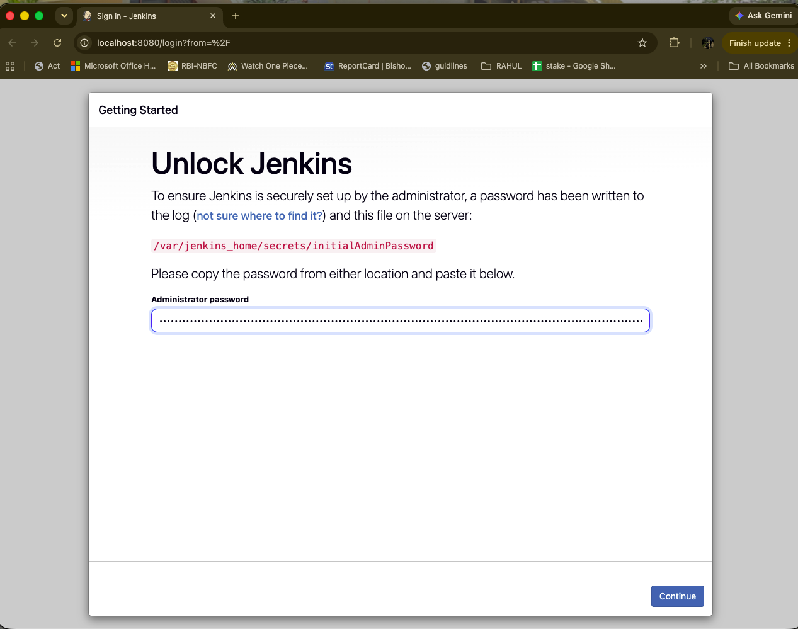

## Step 9: Create and run the Jenkins pipeline

1. Click **New Item**, enter `delivery-pipeline`, choose **Pipeline**, and click **OK**.
2. Under **Pipeline → Definition**, choose **Pipeline script** and paste the contents of the `Jenkinsfile`.
3. Click **Save**, then **Build Now**.
4. Open the build and check **Console Output**.

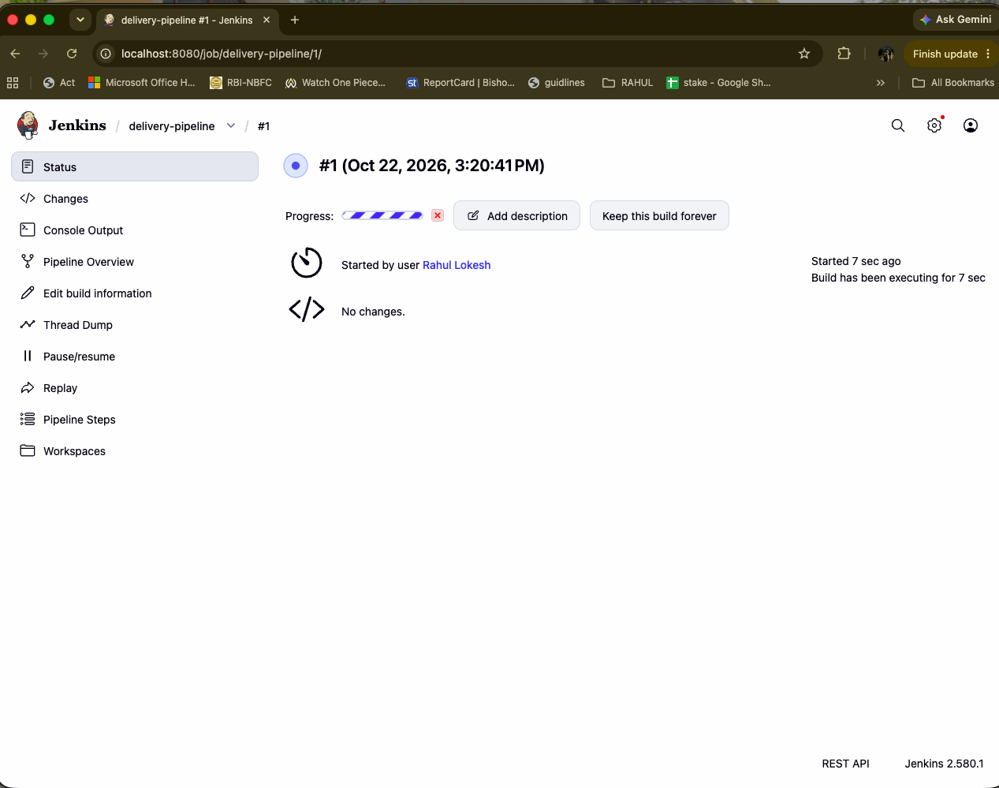

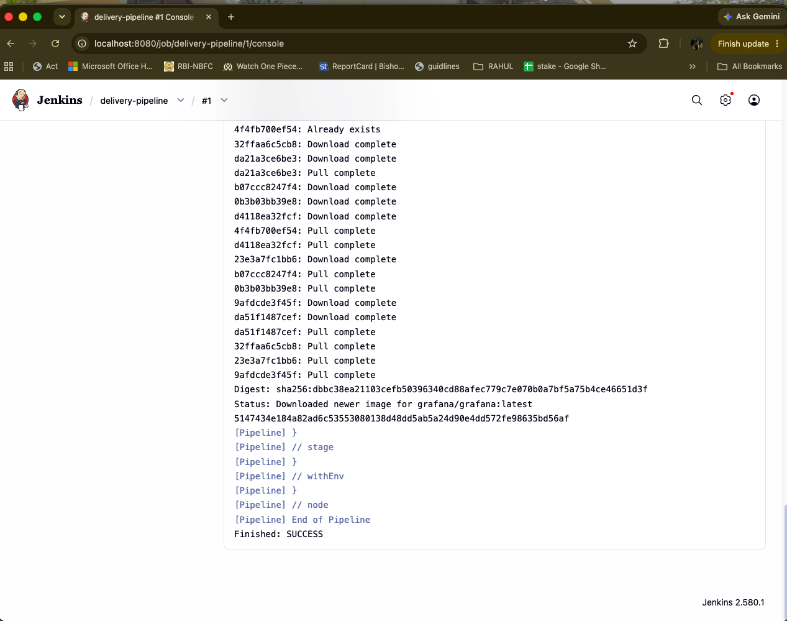

Verify all containers are up:
```bash
docker ps --format "table {{.Names}}\t{{.Status}}\t{{.Ports}}"
```

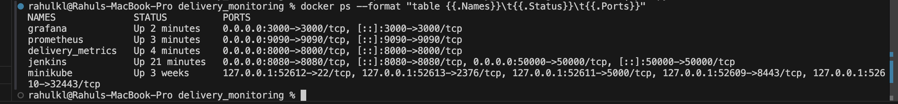

## Step 10: Verify Prometheus targets and alerts

Open [http://localhost:9090/targets](http://localhost:9090/targets). Both `prometheus` and `delivery_service` should show as **UP**.

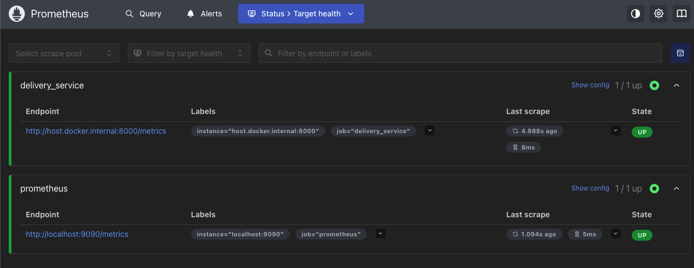

Open [http://localhost:9090/alerts](http://localhost:9090/alerts). With normal values both rules are **Inactive**.

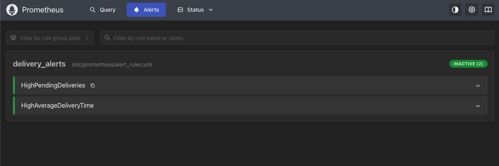

Query `pending_deliveries` on the Graph page to see the live series:

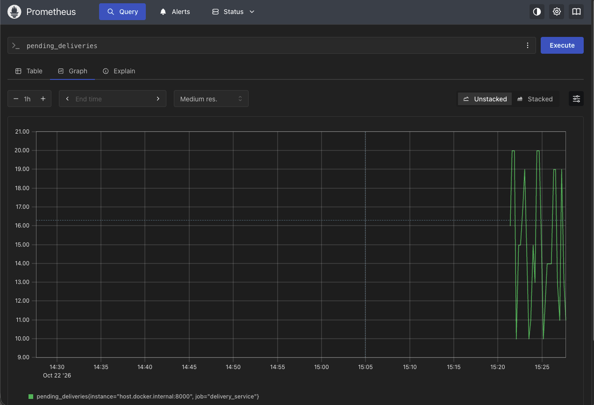

## Step 11: Set up Grafana

```bash
docker run -d --name grafana -p 3000:3000 grafana/grafana
```
(The Jenkins pipeline already starts Grafana, so this command is only needed for running it manually.)

1. Open [http://localhost:3000](http://localhost:3000) and log in with `admin` / `admin`, then skip the password change.
2. Go to **Connections → Data sources → Add data source → Prometheus**.
3. Set the URL to `http://host.docker.internal:9090` and click **Save & test**.

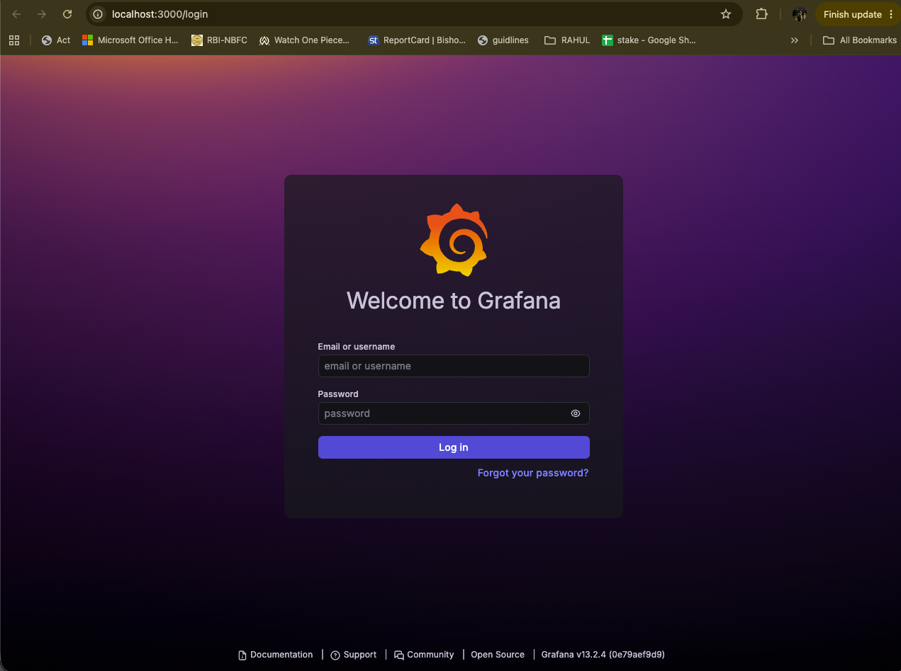

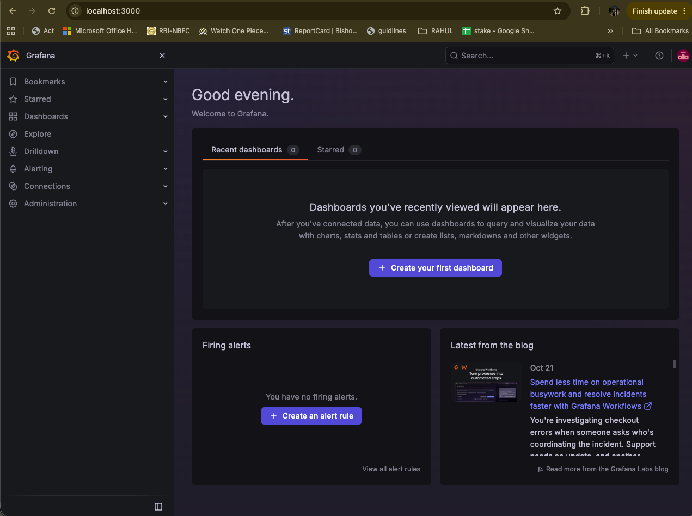

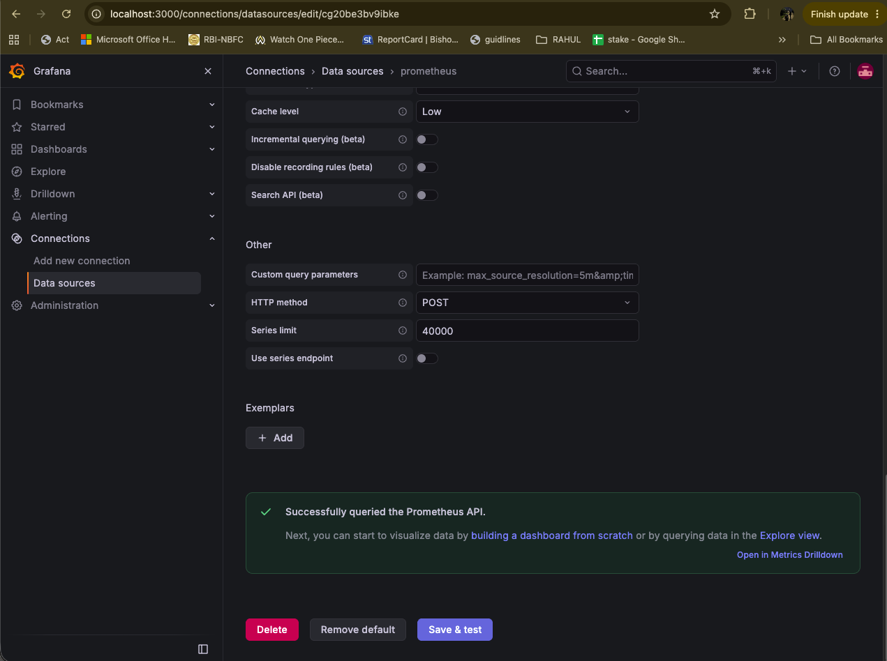

## Step 12: Build the dashboard

Create one dashboard named **Delivery Monitoring** with four panels:

| Panel | PromQL Query |
|---|---|
| Total Deliveries | `total_deliveries` |
| Pending Deliveries | `pending_deliveries` |
| On-the-Way Deliveries | `on_the_way_deliveries` |
| Average Delivery Time | `rate(average_delivery_time_sum[1m]) / rate(average_delivery_time_count[1m])` |

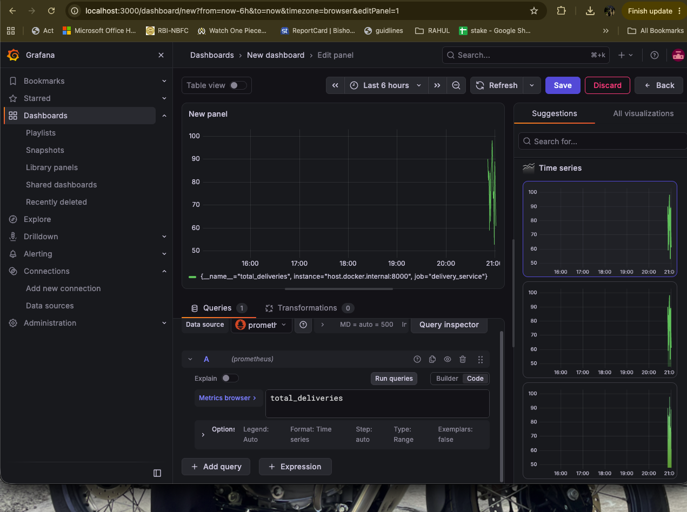

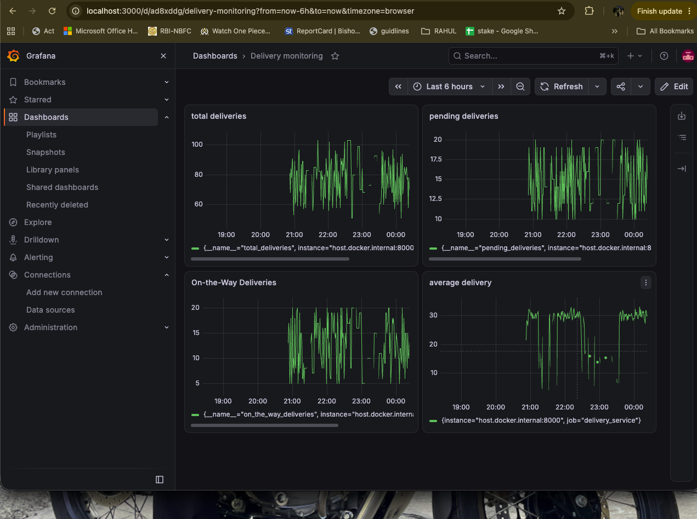

## Step 13: Simulate alerts

Change the simulated values in `delivery_metrics.py` so they exceed both alert thresholds:

```python
pending = random.randint(50, 100)
avg_time = random.uniform(40, 60)
```

Then click **Build Now** in Jenkins again. The pipeline removes the old containers, rebuilds the image with the new values, and starts the stack again.

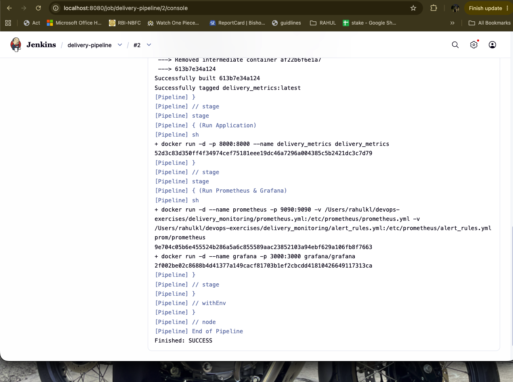

After about 1 to 2 minutes, open [http://localhost:9090/alerts](http://localhost:9090/alerts). Both alerts move from **Pending** to **Firing**.

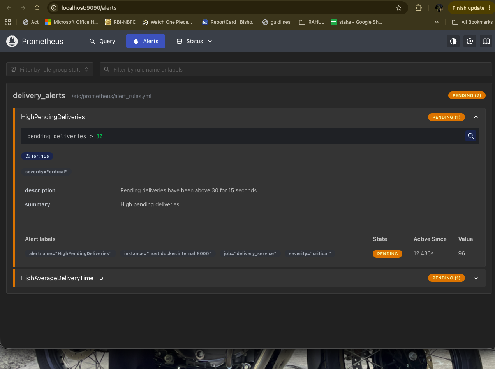

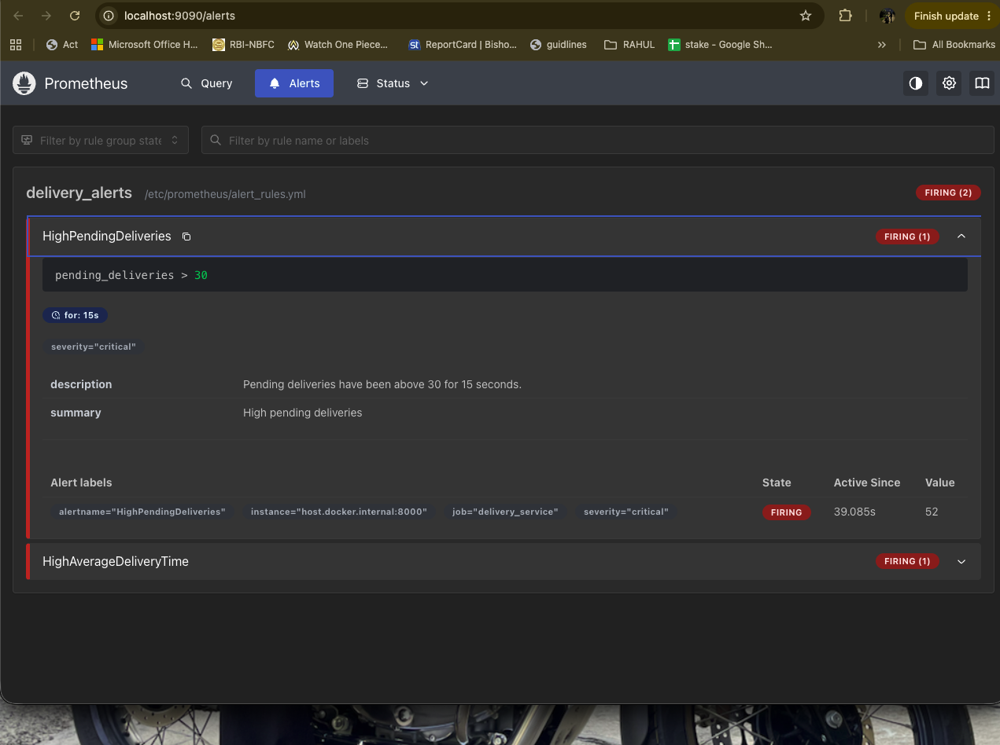

- **HighPendingDeliveries** (`critical`): value above 30 (for example `52`), active for more than 15 seconds.
- **HighAverageDeliveryTime** (`warning`): average delivery time above 35 seconds over the last minute.

The Grafana container is recreated by the pipeline, so the data source and dashboard have to be set up again (Steps 11 and 12) to see the spike on the panels.

## Issues Encountered and Fixes

| Issue | Cause | Fix |
|---|---|---|
| `--network=host` and `172.17.0.1` do not work | Docker Desktop on macOS runs containers inside a VM | Use `host.docker.internal` as the target host |
| Jenkins `docker: not found` | The Jenkins image does not include the Docker CLI | Mount `/var/run/docker.sock` and install the Docker CLI inside the container |
| Docker build failed: no Dockerfile | The original exercise had no Dockerfile | Added a `Dockerfile` for the metrics application |
| Port or container name conflicts | Manually started containers clashed with the pipeline | Added a "Clean old containers" stage that runs `docker rm -f` first |
| Average delivery time alert was misleading | `sum / count` is an average since startup, not recent | Used `rate(...[1m])` for a recent average and added a `for:` clause |
| Jenkins plugins showed a red ✗ during setup | Download timeouts on first run | Used **Retry**, then installed the plugins from **Manage Jenkins → Plugins** |

## Cleanup

```bash
docker rm -f delivery_metrics prometheus grafana jenkins
```

## Expected Outputs: Achieved

1. **Metrics Endpoint**: confirmed working at `http://localhost:8000/metrics`.
2. **Prometheus Scraping**: both targets `UP`, scraping every 5 seconds.
3. **Grafana Dashboard**: four panels visualizing live delivery metrics.
4. **Jenkins Pipeline**: successful build with logs for the Docker commands.
5. **Prometheus Alerts**: both alert rules fired after the simulated spike.
